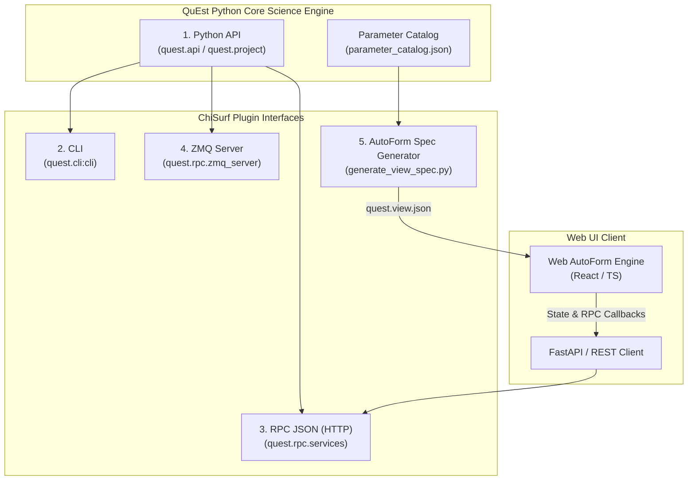

# Architecture Overview: ChiSurf Plugin Compatibility & Web AutoForm

This specification defines how **QuEst** implements the **ChiSurf Plugin Standard** across 5 unified execution interfaces, bringing desktop-grade AutoForm declarative rendering to modern web applications.

---

# PRD 1: Web AutoForm Engine (React / WebUI)

### Objective
Provide a native, schema-driven React **Web AutoForm** component tree that dynamically renders complex hierarchical configuration forms directly from ChiSurf AutoForm view-spec JSON (`quest.view.json` or any plugin `.view.json`).

### Requirements
1. **Dynamic Section Dispatching**:
   - `panel`: Accordion / collapsible container holding an ordered list of child sections.
   - `value`: Scalar input (`kind`: int, float, str, text) with unit labels, help badges, step sizes, and dirty state tracking.
   - `choice`: Dropdown/radio selector supporting inline options or dynamic catalog parameter options.
   - `toggle` / `toggle_row`: Checkbox toggle inputs.
   - `button_row`: Action trigger buttons.
   - `table` / `custom`: Tabular record displays and bespoke extension slot renderers.
2. **State & Event Binding**:
   - Accepts `spec` (JSON tree), `data` (current project JSON object), `onChange(path, value)`, `onSave(path)`, and `catalog`.
   - Resolves target paths (e.g. `attachment.chain`, `fret.R0_matrix`) using dot-notation getters/setters.
3. **Localisation Seam**:
   - Integrates with `t(key, fallback)` or uses translated text directly from localized view specs (`quest.view.de.json`, `quest.view.fr.json`).

---

# PRD 2: ChiSurf 5-Way Plugin Interface Compatibility

### Objective
Ensure QuEst serves as the gold-standard blueprint for ChiSurf plugins by exposing all 5 standard plugin execution surfaces:

| Surface | Interface Module | Description |
|---|---|---|
| **1. API** | `quest.api` / `quest.project` | Direct Python function imports for scripts and notebooks. |
| **2. CLI** | `quest.cli:cli` | Command-line interface for headless batch runs and pipeline scripting. |
| **3. RPC JSON** | `quest.rpc.services` / `dispatcher.py` | Standalone JSON-RPC 2.0 service dispatcher over HTTP (FastAPI `/api/rpc`). |
| **4. ZMQ** | `quest.rpc.zmq_server` | ZeroMQ REQ/REP server allowing out-of-process RPC execution from any language (C++, Julia, Rust, Python). |
| **5. Web AutoForm** | `quest.view.json` + `webui/frontend` | Dynamic schema-driven web UI form generation replacing PyQt-specific widgets. |

---

# Implementation Checklist

- [x] **Phase 1: Architecture Specification & PRDs**
  - [x] Document ChiSurf 5-way interface standard and Web AutoForm PRDs (`okf/specs/autoform-and-plugin-architecture.md`).
- [ ] **Phase 2: Python Backend ZMQ & RPC Extensions**
  - [ ] Implement `quest.rpc.zmq_server` (ZeroMQ RPC server for QuEst RPC methods).
  - [ ] Extend `quest.rpc.services` and FastAPI backend to expose `/api/autoform-spec` and ZMQ endpoints.
- [ ] **Phase 3: Web AutoForm React Engine (`webui/frontend`)**
  - [ ] Build `src/components/autoform/AutoForm.tsx`.
  - [ ] Build `src/components/autoform/AutoSection.tsx` & `AutoPanel.tsx`.
  - [ ] Build `src/components/autoform/AutoValue.tsx`, `AutoChoice.tsx`, `AutoToggle.tsx`, `AutoButtonRow.tsx`.
  - [ ] Add AutoForm mode toggle / component view in Web UI sidebar.
- [ ] **Phase 4: Tests & Verification**
  - [ ] Python unit tests for ZMQ server (`tests/test_zmq_rpc.py`).
  - [ ] Backend tests for `/api/autoform-spec` & RPC services.
  - [ ] E2E browser tests for Web AutoForm rendering and interactions.
